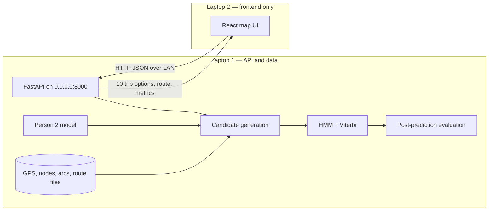

# Two-laptop deployment

## Architecture

Laptop 1 owns the dataset, road network, trained classifier, candidate generator, HMM/Viterbi decoder, and FastAPI service. Laptop 2 runs the React map UI and receives only the ten trip options and prediction/evaluation JSON.



Laptop 2 does not need the raw dataset, model artifact, Python dependencies, or route reconstruction code. Do not put Laptop 1's IP in frontend source; the API base comes from `frontend/.env`.

## Evaluation trip selection

There is no separate checked-in manifest of approved IDs. The local `dataset/Student folder/student_test` partition currently contains exactly these ten complete trips:

`00000000`, `00000007`, `00000009`, `00000040`, `00000052`, `00000056`, `00000065`, `00000076`, `00000077`, `00000091`.

The backend discovers folders with `.track`, `.nodes`, and `.arcs`, sorts their IDs lexically, and returns the first ten. It does not expose `.route` files. Please confirm these are the team's designated ten IDs; the backend does not randomly change them between restarts.

## Laptop 1 — API and data server

Use the checkout that contains `dataset/` and `models/best_model.joblib`. In PowerShell from the repository root:

```powershell
python -m venv .venv
.\.venv\Scripts\python.exe -m pip install -r requirements.txt\requirements.txt
.\.venv\Scripts\python.exe -m uvicorn backend.app:app --host 0.0.0.0 --port 8000
```

The server defaults to `0.0.0.0:8000`, so other devices can reach it. Leave this terminal and laptop running.

Find Laptop 1's private IPv4 address:

```powershell
Get-NetIPAddress -AddressFamily IPv4 | Where-Object { $_.IPAddress -notlike '127.*' -and $_.AddressState -eq 'Preferred' } | Select-Object InterfaceAlias,IPAddress
```

Use the address for the Wi-Fi or Ethernet adapter shared with Laptop 2. Avoid a VPN, virtual adapter, or public-facing address.

If Windows Firewall blocks Python, run PowerShell as administrator on Laptop 1 and allow TCP port 8000 on the private network:

```powershell
New-NetFirewallRule -DisplayName 'PATHSNAP API 8000' -Direction Inbound -Protocol TCP -LocalPort 8000 -Action Allow -Profile Private
```

The rule is optional if an existing firewall policy already permits the connection. Do not expose port 8000 to public networks.

Backend configuration can be overridden with environment variables:

- `PATHSNAP_DATASET_ROOT` (default `./dataset`)
- `PATHSNAP_MODEL_PATH` (default `./models/best_model.joblib`)
- `PATHSNAP_FEATURE_SCHEMA` (default `./models/feature_schema.json`)
- `PATHSNAP_HOST` and `PATHSNAP_PORT` (default `0.0.0.0`, `8000`)
- `PATHSNAP_CORS_ORIGINS` (comma-separated browser origins; default allows localhost Vite)
- `PATHSNAP_CANDIDATE_RADIUS_M`, `PATHSNAP_FALLBACK_RADIUS_M`, `PATHSNAP_MAX_CANDIDATES`
- `PATHSNAP_MAX_SPEED_MPS`
- `PATHSNAP_DEV_FALLBACK` (default `false`; development-only geometry scorer)

Road-network graphs are loaded on demand per requested trip and one graph is cached at a time. `/health` reports model load, dataset availability, the ten trip files, route files, and that network graphs are available for on-demand loading.

## Laptop 2 — frontend client only

Laptop 2 needs Node.js and the frontend source. It does not need Python or the dataset/model. From the repository root in PowerShell:

```powershell
cd frontend
npm install
Copy-Item .env.example .env
notepad .env
```

Set `VITE_API_BASE_URL` in `frontend/.env` to Laptop 1's private IPv4 address, for example `http://192.168.1.25:8000`. The example value `LAPTOP_1_IP` is a placeholder and must be replaced. Do not use `http://localhost:8000` on Laptop 2; that would point to Laptop 2 itself.

Then start the frontend on Laptop 2:

```powershell
npm run dev -- --host 0.0.0.0
```

Open the Vite URL in a browser on Laptop 2, normally `http://localhost:5173`. The API server sees that browser origin, which is allowed by default. If the browser is opened from a different host/origin, add that exact origin to `PATHSNAP_CORS_ORIGINS` on Laptop 1 and restart FastAPI. The origin includes scheme and port, for example `http://192.168.1.40:5173`.

## API contract

### `GET /health`

Reports `status`, `model_name`, `model_loaded`, `scoring_mode`, `dataset_available`, `evaluation_trip_count`, `road_network_files_available`, `ground_truth_files_available`, `road_network_loading`, and `ready_for_inference`.

### `GET /api/evaluation/trips`

Returns exactly ten discovered trip IDs and display labels. No ground-truth route IDs or coordinates are returned.

### `POST /api/evaluation/predict`

Request:

```json
{"trip_id":"00000007"}
```

Successful responses contain `gps_trace`, `predicted_route`, optional `road_network`, `route_arc_ids`, `inference_time_ms`, `decoder`, `scoring_mode`, `warnings`, and post-prediction `evaluation` metrics (`route_edge_precision`, `route_edge_recall`, `route_edge_f1`, and `sequence_similarity`). Coordinate arrays use `[latitude, longitude]`, which matches React Leaflet. Ground-truth route contents are not returned. The backend reads them only after inference has completed to calculate comparison metrics.

Unknown trips return 404, invalid requests return 422, and missing backend resources return 503. A trip with no complete directed path returns an explicit 422 instead of an invented route.

## Test deployment

### Same-machine development check

Start FastAPI using the Laptop 1 command and run the UI locally with `VITE_API_BASE_URL=http://localhost:8000`. Verify health, trip list, and one prediction.

### Required two-laptop check

1. Connect both laptops to the same trusted private Wi-Fi/LAN.
2. On Laptop 1, start FastAPI with `--host 0.0.0.0 --port 8000`; verify `http://localhost:8000/health` locally.
3. On Laptop 2, check reachability using the actual Laptop 1 address:

   ```powershell
   Test-NetConnection LAPTOP_1_IP -Port 8000
   Invoke-RestMethod http://LAPTOP_1_IP:8000/health
   ```

4. Set Laptop 2's `VITE_API_BASE_URL` to `http://LAPTOP_1_IP:8000`, start Vite, and open its page on Laptop 2.
5. Verify the UI shows ten trips, select one successful trip, reconstruct it, and confirm the route and evaluation metrics appear.

A successful localhost test does not prove the two-laptop path. The physical Laptop 2 workflow has not been run from this development machine; it still needs the team's actual LAN test.

## Troubleshooting

- **Connection refused/time out:** confirm Laptop 1 is still running Uvicorn on `0.0.0.0:8000`, use Laptop 1's current private IP, and check `Test-NetConnection` and the Private firewall rule.
- **Browser CORS error:** set the exact Laptop 2 browser origin in `PATHSNAP_CORS_ORIGINS`, then restart the API.
- **UI says API is not ready:** check `/health`; verify dataset root, all ten evaluation folders and route files, and the model/schema paths.
- **Trip request returns 404:** use only one of the ten IDs returned by `/api/evaluation/trips`.
- **Trip request returns 422:** the trip may have no candidates or no complete directed route path; inspect the response message. The backend intentionally avoids fabricating a connection.
- **Laptop IP changes:** refresh `frontend/.env` and restart Vite; no source-code edit is needed.
